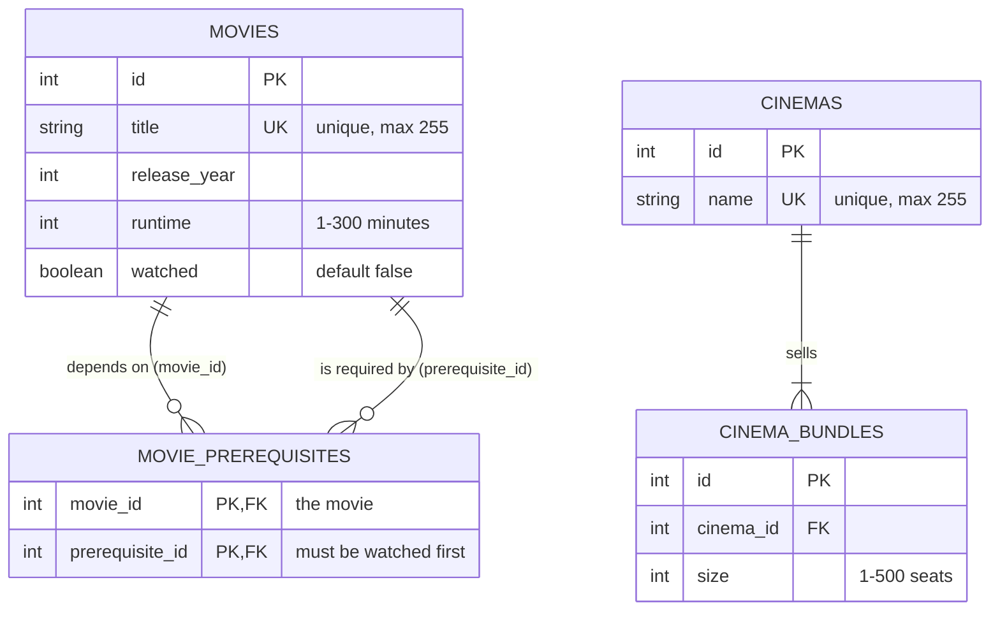

# doomsday_ready

## Data Model

### How it fits together

- **Movie prerequisites** form a directed graph. `movie_prerequisites` is a
  join table: each row means "watch `prerequisite_id` before `movie_id`".
  Both columns point to `movies`, so a movie can have many prerequisites
  and can be a prerequisite of many movies.
- A row can never have `movie_id = prerequisite_id` (database check
  constraint). Longer loops (A -> B -> A) are rejected by the API with
  `409 CIRCULAR_DEPENDENCY` before they are saved.
- **Cinemas** sell seat bundles. Each size is its own row in `cinema_bundles`,
  and `(cinema_id, size)` is unique, so a cinema can't list the same size
  twice. The rule "1 to 10 sizes per cinema" is validated in the API.
- Deleting a movie or cinema deletes its link/bundle rows (`ON DELETE CASCADE`).