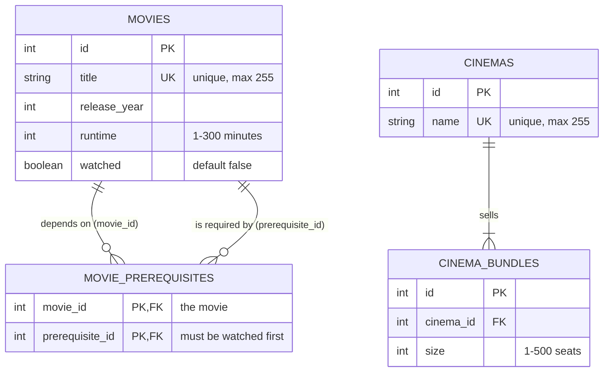

# Doomsday Ready

## Getting Started

### Requirements

- [Git](https://git-scm.com/downloads)
- [Docker](https://docs.docker.com/get-docker/) with Docker Compose v2
  (included in Docker Desktop; on Linux install the `docker-compose-plugin`)

Check that they are installed:

```bash
git --version
docker --version
docker compose version
```

Nothing else is needed.

### 1. Download the project

```bash
git clone https://github.com/RAKIBUL424/doomsday_ready.git
cd doomsday_ready
```

### 2. Run everything with one command

```bash
docker compose up --build
```

The first run downloads base images and builds the app, so it can take a few
minutes. When it is ready you will see these lines in the log:

```
Seed done: 8 movies added
Uvicorn running on http://0.0.0.0:8000
```

On every start, the backend automatically:

1. waits for PostgreSQL to be healthy,
2. runs the database migrations (Alembic),
3. loads the sample movies from `backend/data/movies.csv`
   (the example data from the assignment; existing titles are skipped, so
   restarting never creates duplicates),
4. starts the API.

`.env` file is also pushed to the github so that no error happens.

### 3. Open the app

| What | URL |
|---|---|
| Web app (React) | http://localhost:5173 |
| API base | http://localhost:8000/api |
| Interactive API docs (Swagger) | http://localhost:8000/docs |
| Health check | http://localhost:8000/health |

Quick check: open http://localhost:5173, go to **Rewatch Plan**, choose
*Avengers: Doomsday*. It should list the 7 movies to watch first.

### 4. Stop the app

Press `Ctrl+C` in the terminal, or from another terminal:

```bash
docker compose down
```

Your data is kept in a Docker volume, so it is still there next time.

### Reset to a clean state

To delete the database and start again from the sample data:

```bash
docker compose down -v
docker compose up --build
```
## Data Model



### How it fits together

- **Movie prerequisites** form a directed graph. `movie_prerequisites` is a
  join table: each row means "watch `prerequisite_id` before `movie_id`".
  Both columns point to `movies`, so a movie can have many prerequisites
  and can be a prerequisite of many movies.
- A row can never have `movie_id = prerequisite_id` (database check
  constraint). Longer loops (A -> B -> A) are rejected by the API with
  `409 CIRCULAR_DEPENDENCY` before they are saved.
- **Cinemas** sell seat bundles. Each size is its own row in `cinema_bundles`,
  and `(cinema_id, size)` is unique, so a cinema can't list the same size
  twice. The rule "1 to 10 sizes per cinema" is validated in the API.
- Deleting a movie or cinema deletes its link/bundle rows (`ON DELETE CASCADE`).


## How I Used AI

I used AI throughout this project. Here is what I did myself and
where AI helped.

**Understanding the problem.** I was not familiar with MCU watch orders or
how cinema seat bundles work, so I used AI to explain the problem statement
in simple terms. I learned the core ideas (graph traversal with DFS,
cycle detection, and dynamic programming for minimum bundles) with the help
of AI and YouTube tutorials.

**What AI wrote.** I write the first version of most of the code:
the database models, Pydantic schemas, basic service layer, API routers,
Alembic. Docker setup, the CSV seed script is written by AI chatboat, and the React frontend (I
gave an AI agent a structured prompt I wrote with AI's help) is generated with the help of AI agent. I reviewed the code before using it and fixed issues I found. graph.py and booking.py is written with AI. All the exception handeling is used is added by AI.

**Feature 1 and 2 logic.**
- *AI wrote the first version of these algorithms. I traced them by hand with
  the assignment examples and tested them, but I did not write them from
  scratch.*

**Debugging.** I used AI to understand error messages (Docker, SQLAlchemy
async, Alembic) and to improve error handling at the end.
